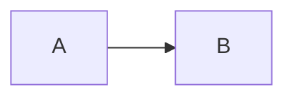
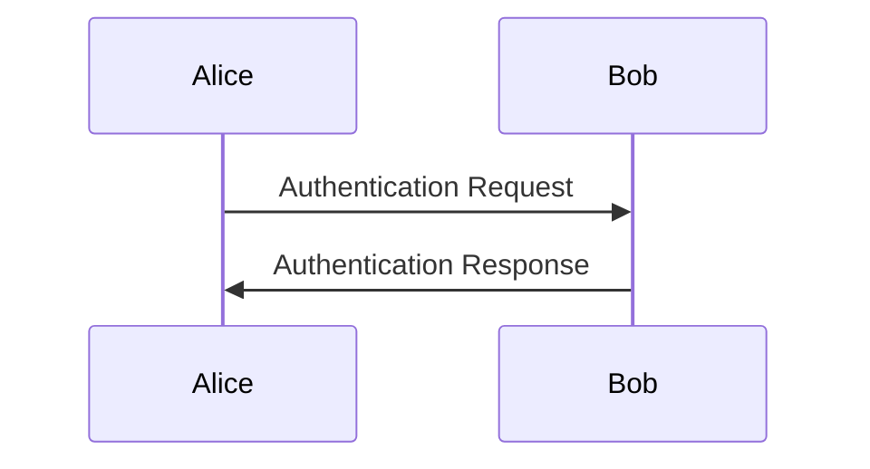

# Diagrams

## PlantUML diagrams

The builder generates diagrams from PlantUML source code. A diagram uses the
`Figure:` (or `figure:`) caption, in the same way as a table caption.

~~~~~markdown
Figure: PlantUML diagram example {#plantuml-example}

~~~plantuml
@startuml
Alice -> Bob: Authentication Request
Bob --> Alice: Authentication Response
@enduml
~~~
~~~~~

Figure: PlantUML diagram example {#plantuml-example}

~~~plantuml
@startuml
Alice -> Bob: Authentication Request
Bob --> Alice: Authentication Response
@enduml
~~~

### Diagrams from files

You can include a diagram from an external file with the standard Markdown image
syntax. The builder supports these file extensions:

- `.puml`, `.plantuml` -- PlantUML
- `.mmd`, `.mermaid` -- Mermaid
- `.typ` -- Typst
- `.drawio` -- Draw.io
- `.d2` -- D2

~~~markdown

~~~

The builder replaces an image that refers to a file with a supported extension
with the rendered diagram. Captions work in the same way as for inline diagrams:

~~~markdown
Figure: Diagram caption {#label}


~~~

Figure: PlantUML diagram from a file {#plantuml-file-example}


### Show the diagram code {#show-diagram-code}

Sometimes you must show the source code of a diagram without rendering, for
example in training materials. To do this, add the `.as-code` class to the code
block:

~~~markdown

~~~

The builder shows a code block with the `.as-code` class as a usual code block
with syntax highlighting. The builder does not convert it to a diagram. This
works for all diagram types: `mermaid`, `plantuml`, `typst`, `d2`.

## Mermaid diagrams

The builder supports diagrams in the [Mermaid](https://mermaid.js.org/) format.

~~~~~markdown
Figure: Mermaid diagram example {#mermaid-example}

~~~mermaid
sequenceDiagram
    Alice->>Bob: Authentication Request
    Bob->>Alice: Authentication Response
~~~
~~~~~

Figure: Mermaid diagram example {#mermaid-example}



### Mermaid and PDF {#mermaid-pdf}

Mermaid diagrams are best for HTML documents. In HTML, the browser renders the
diagrams with the Mermaid JavaScript library by default.

For PDF, the builder generates Mermaid diagrams locally with `mmdc`
(mermaid-cli) or with the built-in renderer.

The `mermaid_render` theme parameter sets the Mermaid render mode:

- `client` (default for HTML) -- the browser renders the diagram with a library
  from a CDN.
- `cli` -- the builder generates SVG locally with `mmdc` (mermaid-cli).
- `builtin` -- the builder generates SVG locally with the built-in renderer
  (experimental).

For PDF, if `mermaid_render` is not set, the builder tries `mmdc` first. If
`mmdc` is not available, the builder uses the built-in renderer.

## Typst diagrams

The builder supports diagrams in the [Typst](https://typst.app/) language. You
can use Typst libraries to make diagrams, for example
[CeTZ](https://typst.app/universe/package/cetz/) or
[Fletcher](https://typst.app/universe/package/fletcher/).

A diagram block uses the `typst` language. To show Typst code without a rendered
diagram, use the `.as-code` class (see [Show the diagram
code](#show-diagram-code)).

~~~~~markdown
Figure: Typst diagram example {#typst-example}

~~~typst
// adapted from https://github.com/cetz-package/cetz/blob/a082e02a/gallery/waves.typ
#import "@preview/cetz:0.4.2": canvas, draw, matrix, vector
#import draw: content, grid, group, line, rotate, scale, set-transform

#canvas({
  // Set up the transformation matrix
  set-transform(matrix.transform-rotate-dir((1, 1, -1.3), (0, 1, .4)))
  scale(x: 1.5, z: -1)
  let arrow-style = (mark: (end: "stealth", fill: black, scale: 0.5))
  // Coordinate axes labels and arrows
  draw.line((0, -2, 0), (0, 2.5, 0), ..arrow-style)
  draw.line((-0.5, 0, 0), (8.5, 0, 0), ..arrow-style)
  draw.line((0, 0, -1.5), (0, 0, 2), ..arrow-style)
  content((0, 0, 2.3), [$arrow(E)$])
  content((0, 3, 0), [$arrow(B)$])
  content((8.7, 0, 0), [$arrow(v)$])

  grid(
    (0, -2),
    (8, 2),
    stroke: gray + .5pt,
  )

  // Draw a sine wave on the xy plane
  let wave(amplitude: 1, fill: none, phases: 2, scale: 8, samples: 100) = {
    line(
      ..(
        for x in range(0, samples + 1) {
          let x = x / samples
          let p = (2 * phases * calc.pi) * x
          ((x * scale, calc.sin(p) * amplitude),)
        }
      ),
      fill: fill,
    )

    let subdivs = 8
    for phase in range(0, phases) {
      let x = phase / phases
      for div in range(1, subdivs + 1) {
        let p = 2 * calc.pi * (div / subdivs)
        let y = calc.sin(p) * amplitude
        let x = x * scale + div / subdivs * scale / phases
        line((x, 0), (x, y), stroke: rgb(0, 0, 0, 150) + .5pt)
      }
    }
  }

  // Draw waves
  group({
    rotate(x: 90deg)
    wave(amplitude: 1.6, fill: rgb(0, 0, 255, 50))
  })
  wave(amplitude: 1, fill: rgb(255, 0, 0, 50))
})
~~~
~~~~~

Figure: Typst diagram example {#typst-example}

~~~typst
// adapted from https://github.com/cetz-package/cetz/blob/a082e02a/gallery/waves.typ
#import "@preview/cetz:0.4.2": canvas, draw, matrix, vector
#import draw: content, grid, group, line, rotate, scale, set-transform

#canvas({
  // Set up the transformation matrix
  set-transform(matrix.transform-rotate-dir((1, 1, -1.3), (0, 1, .4)))
  scale(x: 1.5, z: -1)
  let arrow-style = (mark: (end: "stealth", fill: black, scale: 0.5))
  // Coordinate axes labels and arrows
  draw.line((0, -2, 0), (0, 2.5, 0), ..arrow-style)
  draw.line((-0.5, 0, 0), (8.5, 0, 0), ..arrow-style)
  draw.line((0, 0, -1.5), (0, 0, 2), ..arrow-style)
  content((0, 0, 2.3), [$arrow(E)$])
  content((0, 3, 0), [$arrow(B)$])
  content((8.7, 0, 0), [$arrow(v)$])

  grid(
    (0, -2),
    (8, 2),
    stroke: gray + .5pt,
  )

  // Draw a sine wave on the xy plane
  let wave(amplitude: 1, fill: none, phases: 2, scale: 8, samples: 100) = {
    line(
      ..(
        for x in range(0, samples + 1) {
          let x = x / samples
          let p = (2 * phases * calc.pi) * x
          ((x * scale, calc.sin(p) * amplitude),)
        }
      ),
      fill: fill,
    )

    let subdivs = 8
    for phase in range(0, phases) {
      let x = phase / phases
      for div in range(1, subdivs + 1) {
        let p = 2 * calc.pi * (div / subdivs)
        let y = calc.sin(p) * amplitude
        let x = x * scale + div / subdivs * scale / phases
        line((x, 0), (x, y), stroke: rgb(0, 0, 0, 150) + .5pt)
      }
    }
  }

  // Draw waves
  group({
    rotate(x: 90deg)
    wave(amplitude: 1.6, fill: rgb(0, 0, 255, 50))
  })
  wave(amplitude: 1, fill: rgb(255, 0, 0, 50))
})
~~~

For PDF, the builder puts the diagram directly into the Typst source of the
document. Thus the diagram can use all features of the language (fonts, colors,
packages).

For HTML, the builder generates an SVG image from the diagram source with `typst
compile`. The builder wraps the source in a minimal document with `#set
page(width: auto, height: auto, margin: 0pt)`. As a result, the SVG has no
margins around the content.

You can also include Typst diagrams from external `.typ` files:

~~~markdown

~~~

The `typst` command must be in `PATH`.

## Draw.io diagrams

The builder supports [Draw.io](https://www.drawio.com/) diagrams (`.drawio`
files). You can include Draw.io diagrams only from external files. The builder
does not support inline code blocks for Draw.io.

~~~markdown

~~~

If the file has more than one page, set the page number in the link fragment.
Page numbers start at 1:

~~~markdown

~~~

Captions work in the same way as for other diagrams:

~~~markdown
Figure: High-level architecture {#arch-drawio}


~~~

Figure: High-level architecture {#arch-drawio}


During the build, the `drawio` command-line tool converts `.drawio` files to
SVG. The tool must be installed and available in `PATH`.

## D2 diagrams

The builder supports diagrams in the [D2](https://d2lang.com/) format. D2 is a
declarative language for diagrams.

~~~~~markdown
Figure: D2 diagram example {#d2-example}

~~~d2 {width=50%}
vars: {
  d2-config: {
    layout-engine: elk
    # Terminal theme code
    theme-id: 300
  }
}
network: {
  cell tower: {
    satellites: {
      shape: stored_data
      style.multiple: true
    }

    transmitter

    satellites -> transmitter: send
    satellites -> transmitter: send
    satellites -> transmitter: send
  }

  online portal: {
    ui: {shape: hexagon}
  }

  data processor: {
    storage: {
      shape: cylinder
      style.multiple: true
    }
  }

  cell tower.transmitter -> data processor.storage: phone logs
}

user: {
  shape: person
  width: 130
}

user -> network.cell tower: make call
user -> network.online portal.ui: access {
  style.stroke-dash: 3
}

api server -> network.online portal.ui: display
api server -> logs: persist
logs: {shape: page; style.multiple: true}

network.data processor -> api server
~~~
~~~~~

Figure: D2 diagram example {#d2-example}

```d2 {width=50%}
vars: {
  d2-config: {
    layout-engine: elk
    # Terminal theme code
    theme-id: 300
  }
}
network: {
  cell tower: {
    satellites: {
      shape: stored_data
      style.multiple: true
    }

    transmitter

    satellites -> transmitter: send
    satellites -> transmitter: send
    satellites -> transmitter: send
  }

  online portal: {
    ui: {shape: hexagon}
  }

  data processor: {
    storage: {
      shape: cylinder
      style.multiple: true
    }
  }

  cell tower.transmitter -> data processor.storage: phone logs
}

user: {
  shape: person
  width: 130
}

user -> network.cell tower: make call
user -> network.online portal.ui: access {
  style.stroke-dash: 3
}

api server -> network.online portal.ui: display
api server -> logs: persist
logs: {shape: page; style.multiple: true}

network.data processor -> api server
```

You can also include D2 diagrams from external `.d2` files:

~~~markdown

~~~

Captions work in the same way as for other diagrams:

~~~markdown
Figure: Diagram caption {#label}


~~~

During the build, the `d2` command-line tool generates SVG from D2 diagrams. The
tool must be installed and available in `PATH`.

:::caution
## Caution

At this time, the D2 project looks
[abandoned](https://github.com/terrastruct/d2/issues/2735). D2 shows some
diagram types well, for example entity diagrams. But do not use D2 in new
documents.
:::
