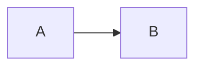
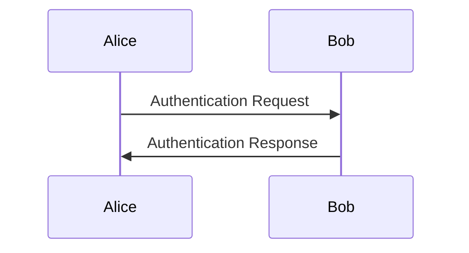

# Диаграммы

## Диаграммы PlantUML

Сборщик умеет автоматически генерировать диаграммы из исходного кода на
PlantUML. Для диаграмм используется подпись `Figure:` (или `figure:`) аналогично
подписям таблиц.

~~~~~markdown
Figure: Пример диаграммы PlantUML {#plantuml-example}

~~~plantuml
@startuml
Alice -> Bob: Authentication Request
Bob --> Alice: Authentication Response
@enduml
~~~
~~~~~

Figure: Пример диаграммы PlantUML {#plantuml-example}

~~~plantuml
@startuml
Alice -> Bob: Authentication Request
Bob --> Alice: Authentication Response
@enduml
~~~

### Диаграммы из файлов

Диаграммы можно подключать из внешних файлов, используя стандартный синтаксис
изображений Markdown. Поддерживаемые расширения:

- `.puml`, `.plantuml` — PlantUML
- `.mmd`, `.mermaid` — Mermaid
- `.typ` — Typst
- `.drawio` — Draw.io
- `.d2` — D2

~~~markdown

~~~

Изображение, ссылающееся на файл с поддерживаемым расширением, автоматически
заменяется на отрендеренную диаграмму. Подписи работают так же, как и для
встроенных диаграмм:

~~~markdown
Figure: Подпись диаграммы {#label}


~~~

Figure: Пример подключения диаграммы PlantUML из файла {#plantuml-file-example}


### Отображение кода диаграммы {#отображение-кода-диаграммы}

Иногда требуется показать исходный код диаграммы без её рендеринга — например, в
обучающих материалах. Для этого добавьте класс `.as-code` к блоку кода:

~~~markdown

~~~

Блок кода с классом `.as-code` будет отображаться как обычный синтаксически
подсвеченный блок кода, без преобразования в диаграмму. Это работает для всех
типов диаграмм: `mermaid`, `plantuml`, `typst`, `d2`.

## Диаграммы Mermaid

Сборщик поддерживает диаграммы в формате [Mermaid](https://mermaid.js.org/).

~~~~~markdown
Figure: Пример диаграммы Mermaid {#mermaid-example}

~~~mermaid
sequenceDiagram
    Alice->>Bob: Authentication Request
    Bob->>Alice: Authentication Response
~~~
~~~~~

Figure: Пример диаграммы Mermaid {#mermaid-example}



### Mermaid и PDF {#mermaid-pdf}

Диаграммы Mermaid лучше всего подходят для документов в формате HTML: в HTML
диаграммы по умолчанию отображаются в браузере с помощью JavaScript-библиотеки
Mermaid, что обеспечивает наилучшее качество визуализации.

Для формата PDF диаграммы Mermaid генерируются локально с помощью `mmdc`
(mermaid-cli) или встроенного рендерера.

Режим рендеринга Mermaid настраивается в теме через параметр `mermaid_render`:

- `client` (по умолчанию для HTML) — отрисовка в браузере через CDN.
- `cli` — локальная генерация SVG через `mmdc` (mermaid-cli).
- `builtin` — локальная генерация SVG встроенным рендерером (экспериментально).

Для PDF, если `mermaid_render` не задан, сборщик сначала попытается использовать
`mmdc`, а при его отсутствии — встроенный рендерер.

## Диаграммы Typst

Сборщик поддерживает диаграммы, описанные на языке [Typst](https://typst.app/).
Это позволяет использовать библиотеки Typst для создания диаграмм, например
[CeTZ](https://typst.app/universe/package/cetz/) или
[Fletcher](https://typst.app/universe/package/fletcher/).

Для блоков с диаграммами используется язык `typst`. Чтобы показать код Typst без
рендеринга диаграммы, используйте класс `.as-code` (см. [Отображение кода
диаграммы](#отображение-кода-диаграммы)).

~~~~~markdown
Figure: Пример диаграммы Typst {#typst-example}

~~~typst
// adapted from https://github.com/cetz-package/cetz/blob/a082e02a/gallery/waves.typ
#import "@preview/cetz:0.4.2": canvas, draw, matrix, vector
#import draw: content, grid, group, line, rotate, scale, set-transform

#canvas({
  // Set up the transformation matrix
  set-transform(matrix.transform-rotate-dir((1, 1, -1.3), (0, 1, .4)))
  scale(x: 1.5, z: -1)
  let arrow-style = (mark: (end: "stealth", fill: black, scale: 0.5))
  // Coordinate axes labels and arrows
  draw.line((0, -2, 0), (0, 2.5, 0), ..arrow-style)
  draw.line((-0.5, 0, 0), (8.5, 0, 0), ..arrow-style)
  draw.line((0, 0, -1.5), (0, 0, 2), ..arrow-style)
  content((0, 0, 2.3), [$arrow(E)$])
  content((0, 3, 0), [$arrow(B)$])
  content((8.7, 0, 0), [$arrow(v)$])

  grid(
    (0, -2),
    (8, 2),
    stroke: gray + .5pt,
  )

  // Draw a sine wave on the xy plane
  let wave(amplitude: 1, fill: none, phases: 2, scale: 8, samples: 100) = {
    line(
      ..(
        for x in range(0, samples + 1) {
          let x = x / samples
          let p = (2 * phases * calc.pi) * x
          ((x * scale, calc.sin(p) * amplitude),)
        }
      ),
      fill: fill,
    )

    let subdivs = 8
    for phase in range(0, phases) {
      let x = phase / phases
      for div in range(1, subdivs + 1) {
        let p = 2 * calc.pi * (div / subdivs)
        let y = calc.sin(p) * amplitude
        let x = x * scale + div / subdivs * scale / phases
        line((x, 0), (x, y), stroke: rgb(0, 0, 0, 150) + .5pt)
      }
    }
  }

  // Draw waves
  group({
    rotate(x: 90deg)
    wave(amplitude: 1.6, fill: rgb(0, 0, 255, 50))
  })
  wave(amplitude: 1, fill: rgb(255, 0, 0, 50))
})
~~~
~~~~~

Figure: Пример диаграммы Typst {#typst-example}

~~~typst
// adapted from https://github.com/cetz-package/cetz/blob/a082e02a/gallery/waves.typ
#import "@preview/cetz:0.4.2": canvas, draw, matrix, vector
#import draw: content, grid, group, line, rotate, scale, set-transform

#canvas({
  // Set up the transformation matrix
  set-transform(matrix.transform-rotate-dir((1, 1, -1.3), (0, 1, .4)))
  scale(x: 1.5, z: -1)
  let arrow-style = (mark: (end: "stealth", fill: black, scale: 0.5))
  // Coordinate axes labels and arrows
  draw.line((0, -2, 0), (0, 2.5, 0), ..arrow-style)
  draw.line((-0.5, 0, 0), (8.5, 0, 0), ..arrow-style)
  draw.line((0, 0, -1.5), (0, 0, 2), ..arrow-style)
  content((0, 0, 2.3), [$arrow(E)$])
  content((0, 3, 0), [$arrow(B)$])
  content((8.7, 0, 0), [$arrow(v)$])

  grid(
    (0, -2),
    (8, 2),
    stroke: gray + .5pt,
  )

  // Draw a sine wave on the xy plane
  let wave(amplitude: 1, fill: none, phases: 2, scale: 8, samples: 100) = {
    line(
      ..(
        for x in range(0, samples + 1) {
          let x = x / samples
          let p = (2 * phases * calc.pi) * x
          ((x * scale, calc.sin(p) * amplitude),)
        }
      ),
      fill: fill,
    )

    let subdivs = 8
    for phase in range(0, phases) {
      let x = phase / phases
      for div in range(1, subdivs + 1) {
        let p = 2 * calc.pi * (div / subdivs)
        let y = calc.sin(p) * amplitude
        let x = x * scale + div / subdivs * scale / phases
        line((x, 0), (x, y), stroke: rgb(0, 0, 0, 150) + .5pt)
      }
    }
  }

  // Draw waves
  group({
    rotate(x: 90deg)
    wave(amplitude: 1.6, fill: rgb(0, 0, 255, 50))
  })
  wave(amplitude: 1, fill: rgb(255, 0, 0, 50))
})
~~~

При создании **PDF** диаграмма включается непосредственно в исходный код
документа на Typst — это обеспечивает наилучшее качество и поддержку всех
возможностей языка (шрифты, цвета, пакеты).

При создании **HTML** из исходного кода диаграммы генерируется изображение SVG с
помощью `typst compile`. Исходный код автоматически оборачивается в минимальный
документ с `#set page(width: auto, height: auto, margin: 0pt)`, чтобы SVG был
плотно обрезан по содержимому.

Диаграммы Typst также можно подключать из внешних `.typ` файлов:

~~~markdown

~~~

Команда `typst` должна находиться в `PATH`.

## Диаграммы Draw.io

Сборщик поддерживает диаграммы [Draw.io](https://www.drawio.com/) (`.drawio`
файлы). В отличие от PlantUML, D2 и Mermaid, диаграммы Draw.io подключаются
только из внешних файлов — встроенные блоки кода не поддерживаются.

~~~markdown

~~~

Если файл содержит несколько страниц, нужную страницу можно указать через
фрагмент ссылки (нумерация с 1):

~~~markdown

~~~

Подписи работают так же, как и для других диаграмм:

~~~markdown
Figure: Архитектура верхнего уровня {#arch-drawio}


~~~

Figure: Архитектура верхнего уровня {#arch-drawio}


При сборке `.drawio` файлы автоматически конвертируются в SVG с помощью утилиты
командной строки `drawio`. Утилита должна быть установлена и доступна в `PATH`.

## Диаграммы D2

Сборщик поддерживает диаграммы в формате [D2](https://d2lang.com/) —
декларативного языка для описания диаграмм.

~~~~~markdown
Figure: Пример диаграммы D2 {#d2-example}

~~~d2 {width=50%}
vars: {
  d2-config: {
    layout-engine: elk
    # Terminal theme code
    theme-id: 300
  }
}
network: {
  cell tower: {
    satellites: {
      shape: stored_data
      style.multiple: true
    }

    transmitter

    satellites -> transmitter: send
    satellites -> transmitter: send
    satellites -> transmitter: send
  }

  online portal: {
    ui: {shape: hexagon}
  }

  data processor: {
    storage: {
      shape: cylinder
      style.multiple: true
    }
  }

  cell tower.transmitter -> data processor.storage: phone logs
}

user: {
  shape: person
  width: 130
}

user -> network.cell tower: make call
user -> network.online portal.ui: access {
  style.stroke-dash: 3
}

api server -> network.online portal.ui: display
api server -> logs: persist
logs: {shape: page; style.multiple: true}

network.data processor -> api server
~~~
~~~~~

Figure: Пример диаграммы D2 {#d2-example}

```d2 {width=50%}
vars: {
  d2-config: {
    layout-engine: elk
    # Terminal theme code
    theme-id: 300
  }
}
network: {
  cell tower: {
    satellites: {
      shape: stored_data
      style.multiple: true
    }

    transmitter

    satellites -> transmitter: send
    satellites -> transmitter: send
    satellites -> transmitter: send
  }

  online portal: {
    ui: {shape: hexagon}
  }

  data processor: {
    storage: {
      shape: cylinder
      style.multiple: true
    }
  }

  cell tower.transmitter -> data processor.storage: phone logs
}

user: {
  shape: person
  width: 130
}

user -> network.cell tower: make call
user -> network.online portal.ui: access {
  style.stroke-dash: 3
}

api server -> network.online portal.ui: display
api server -> logs: persist
logs: {shape: page; style.multiple: true}

network.data processor -> api server
```

Диаграммы D2 также можно подключать из внешних `.d2` файлов:

~~~markdown

~~~

Подписи работают так же, как и для других диаграмм:

~~~markdown
Figure: Подпись диаграммы {#label}


~~~

При сборке диаграммы D2 генерируются в SVG с помощью утилиты командной строки
`d2`. Утилита должна быть установлена и доступна в `PATH`.

:::caution
## Осторожно

Проект D2 выглядит на текущий момент
[заброшенным](https://github.com/terrastruct/d2/issues/2735), поэтому, несмотря
на преимущества в отображении, например, диаграмм сущностей, его применение
нежелательно.
:::
