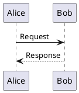

# Writing documentation for docbake

`docbake` compiles a tree of Markdown files into a single document. Output
formats are single-page HTML, multi-page HTML, PDF, Typst, Markdown, and DOCX.
The same document can be published to Confluence and Google Docs.

The Markdown engine is `rushdown` with project extensions. The base syntax is
CommonMark. GitHub-only syntax such as `> [!NOTE]` callouts does not work.

The builder validates every internal link at build time. A link to a missing
anchor in another file (`file.md#id`) stops the build. A link to a missing
anchor in the same file (`#id`, or a link by heading title) only prints a
warning, and the exit status stays 0. Read the warnings in the `check` output.
Most of the rules below exist to keep anchors stable and links valid.

## Before you write

1. Find the root file. It holds the YAML front matter and the top-level
   `:::include` block. In the docbake repository itself the root is
   `doc/en/index.md`.
2. Read one or two neighbouring files first. Match their language, tone, and
   heading depth.
3. Match the formatting the `fmt` command produces: paragraphs wrapped at 80
   columns, aligned pipe tables, ATX headings, renumbered ordered lists, no
   trailing whitespace, single blank lines, no blank line after the front
   matter. Run `fmt` on the files you change.
4. Verify your changes before you report them as done:

```bash
docbake check -f html -i doc/en/index.md -b doc
docbake fmt --check doc/en
```

`check` resolves every anchor and renders every diagram without writing output
files. Run it once per visibility profile you care about (`html`, `pdf`, `docx`,
`confluence`, `markdown`), because conditional blocks change what is visible.
When the builder is not installed, run it from a checkout of the docbake source
with `cargo run -- check -f html ...`. `references/cli.md` lists every builder
command and flag.

## Document structure

### Front matter

Only the root file's front matter is used. Front matter in included files is
removed during assembly. The built-in theme needs `title` for the `page` and
`site` formats. All other fields are optional.

```yaml
---
title:    Document Title
subtitle: Optional Subtitle
author:   Author Name
version:  1.0.0
lang:     ru-RU
date:     2025-01-15
keywords: keyword1, keyword2
variants: ["enterprise", "internal"]
logo: assets/logo.svg
confluence:
  server: https://confluence.example.com
  space: PROJ
  path:
    - "Parent Page"
    - "Document Title"
google-docs:
  id: 1AbCdEf
  folder: 2GhIjKl
---
```

`title`, `subtitle`, `author`, `version`
:  Shown on the PDF title page and in document properties.

`lang`
:  RFC 5646 language tag, for example `ru-RU` or `en-US`. Sets the `lang`
   attribute in HTML and PDF.

`date`
:  `YYYY-MM-DD` or `YYYY-MM-DD HH:MM:SS`.

`keywords`
:  String or array. Written to PDF properties and HTML metadata.

`variants`
:  Array of strings. Selects which `if-variant` blocks are visible. See
   [Conditional content](#conditional-content).

`logo`
:  Path to an SVG, PNG, or JPEG file that replaces the theme logo. The file
   must be in the base directory. A missing file stops the build.

`confluence`
:  Publishing target. `path` is a string or an array. The last element is the
   page title; earlier elements are the ancestor chain. An element can be a page
   title or a literal ID in the form `id:12345678`. Without `path`, the page
   title is `title`.

`google-docs`
:  `id` selects an existing Google Doc to update. `folder` selects the Drive
   folder for a new document.

Any field can be overridden at build time with `--meta`, `--meta-drop`, and
`--meta-file`. Each `--meta variants <value>` adds one value to the `variants`
array.

### File includes

Files are assembled with an `:::include` block. Each line inside the block is a
Markdown heading whose link points at the file to include.

```markdown
:::include
# [Section Title](path/to/file.md)
## [Subsection Title](another/file.md)
:::
```

The heading level sets the level shift applied to the included file. A file
included with `#` keeps its heading levels. A file included with `##` has every
heading pushed down one level. A file included with `###` is pushed down two.
The link text is informational and does not appear in the output.

Rules:

- Paths are relative to the file that holds the `:::include` block.
- A path that starts with `/` resolves against the base directory (`-b`).
- Includes nest. Cycles produce an error.
- Links and heading IDs are rewritten so cross-references survive assembly.
- Footnotes from all files are renumbered in document order.

Keep links relative. A section with relative links can be included into a
different parent document without edits.

## Headings and anchors

Put a blank line before and after every heading.

Every heading gets an automatic ID derived from its text:

1. Remove leading digits, hyphens, and underscores: `1. Intro` gives `intro`.
2. Convert to lowercase.
3. Change each run of spaces, hyphens, and underscores to one hyphen.
4. Delete all other ASCII punctuation. Keep `a`-`z`, `0`-`9`, and every
   non-ASCII character, non-ASCII punctuation included.
5. An empty result becomes `heading`.

Examples: `Hello_World: Foo.Bar` gives `hello-world-foobar`.
`## Параметры документа` gives `параметры-документа`. Automatic IDs that repeat
get a `-1`, `-2` suffix in source order. A repeated explicit ID of any kind
stops the build.

Set an explicit ID when the anchor matters:

```markdown
## My Section {#custom-id}
```

An explicit ID survives a rewording of the heading. An automatic ID does not,
and every link that pointed at it then breaks the build.

Two heading classes, `{.unlisted}` and `{.unnumbered}`, remove the heading from
the HTML table of contents. PDF and DOCX ignore both classes.

Headings accept inline markup, but the ID comes from the plain text. Plain
headings are easier to link to.

### Every way to create an anchor

| Element     | Syntax                  | ID source                        |
| ----------- | ----------------------- | -------------------------------- |
| Heading     | `# Text {#id}`          | Explicit, or auto from text      |
| Image       | `{#id}`     | Explicit only                    |
| Caption     | `Table: Caption {#id}`  | Explicit, or auto from caption   |
| Code block  | ` ```lang Description ` | Auto from the description text   |
| Code block  | ` ```lang {#id} `       | Explicit                         |
| Fenced div  | `:::{#id}`              | Explicit                         |
| Inline span | `[text]{#id}`           | Explicit                         |

All anchor types share one namespace, so a code block cannot collide with a
heading.

## Links

```markdown
[Text](https://example.com)
[Text](https://example.com "Title")
[Text](#heading-id)
[Text](path/to/file.md#heading-id)
[Text](path/to/file.md)
```

A link to a file with no fragment targets the first heading in that file.

Two forms let you link by heading text instead of computing the ID. The builder
converts the title string with the heading ID rules and looks for an automatic
heading ID. A heading with an explicit `{#id}` cannot be linked by title; link
to its ID.

```markdown
[Text](# "Exact Heading Text")
[Text](path/to/file.md "Exact Heading Text")
```

Reference links keep long URLs out of the prose. Collect the definitions at the
end of the file.

```markdown
See [RFC 7763] for details.

[RFC 7763]: https://www.rfc-editor.org/rfc/rfc7763.html "The text/markdown Media Type"
```

Angle brackets produce an autolink: `<https://example.com>`,
`<someone@example.com>`.

## Captions and cross-references

A caption is a standalone paragraph that starts with `Table:`, `Figure:`, or
`Listing:`. The lowercase forms `table:`, `figure:`, and `listing:` also work.
Place it directly before or after the block it describes. A caption attaches to
the next block that can take a caption first, then to the previous one. Tables,
images, diagrams, code blocks, and fenced divs take captions. HTML puts the
caption above the block. PDF puts `Listing:` captions above and table and
figure captions below.

```markdown
Table: Applied standards {#standards-table}

| RFC      | Description             |
| -------- | ----------------------- |
| RFC 2822 | Internet Message Format |
```

The `{#id}` is optional. Without it the ID is derived from the caption text.

A table has no other way to get an ID. Add a caption to every table you intend
to link to. Images, diagrams, and fenced divs take an explicit `{#id}`, and code
blocks take an ID from their description, but a caption also gives the block a
number and a title.

`Figure:` applies to images and diagrams. `Listing:` applies to code blocks.
In PDF the three kinds are numbered in separate sequences.

## Admonitions

Six types are available: `note`, `tip`, `warning`, `caution`, `important`, and
`related`. Each has a default title.

```markdown
:::note
Additional information. The default title is applied.
:::
```

A heading as the first element replaces the default title:

```markdown
:::warning
## Compatibility Notice

This feature requires version 2.0 or later.
:::
```

Attribute syntax adds an ID and combines with the conditional attributes:

```markdown
:::{.warning #compat-warning}
## Compatibility

Available since version 2.0.
:::

See [the warning](#compat-warning).
```

Admonitions hold any block content: paragraphs, lists, code blocks, tables, and
other fenced divs.

## Conditional content

Two fenced-div attributes control visibility.

```markdown
:::{if-format="html confluence"}
Visible in HTML and Confluence output only.
:::

:::{if-variant="enterprise"}
Visible when the document metadata lists the enterprise variant.
:::

:::{if-format="html" if-variant="enterprise"}
Visible only when both conditions hold.
:::
```

Evaluation rules:

- Values inside one attribute are space separated and combine with OR.
- Separate attributes combine with AND.
- A block with no conditional attribute is always visible.
- An empty value stops the build.
- An unknown format name stops the build.

The five format names are `html`, `pdf`, `docx`, `confluence`, and `markdown`.
`references/output-formats.md` maps each build and publish command to its
profile.

A hidden block is absent from the selected profile. It contributes nothing to
rendering, the table of contents, the search index, footnote numbering, diagram
checks, or asset copying. The conditional attributes are control data and never
reach the output.

Class-based visibility such as `:::pdf` or `:::{.html .pdf}` has no effect.
Use `if-format`. Ordinary CSS classes on fenced divs still work as classes.

## Text

| Syntax                   | Result        |
| ------------------------ | ------------- |
| `*italic*`, `_italic_`   | italic        |
| `**bold**`, `__bold__`   | bold          |
| `~~strike~~`             | strikethrough |
| `` `code` ``             | inline code   |

Escape any ASCII punctuation character with `\` to keep it literal. Escapes have
no effect inside code spans and code blocks.

A blank line separates paragraphs. A newline inside a paragraph acts as a space.
For a hard line break, end the line with `\`. Two trailing spaces also work, but
`fmt` strips trailing whitespace elsewhere and a lone backslash is visible in
the source.

Attach an ID or class to arbitrary inline text with a bracketed span:

```markdown
[text that needs an anchor]{#my-anchor}
[highlighted text]{.highlight}
```

Raw HTML passes through to HTML output unchanged and is dropped from PDF. Avoid
HTML in documents that target PDF.

## Code blocks

Open with three or more backticks or tildes. Use more fence characters than any
fence inside the block.

Text after the language name is a description. It generates the block ID with
the heading ID rules:

````markdown
```rust Basic Function
fn basic() {}
```
````

That block can be reached with `[link](#basic-function)`.

Attributes follow the language and the optional description:

````markdown
```python HTTP Client {#http-example .important start=1}
import requests
```
````

`{#id}`
:  Explicit ID. Takes priority over the description.

`{.class}`
:  Class on the `<pre>` element.

`{start=N}`
:  Turn on line numbering, starting at N.

`{.as-code}`
:  For a diagram language, show the source as highlighted code instead of
   rendering it.

`{key=value}`
:  Any other attribute is written to the `<pre>` element.

Add a `Listing:` caption when the block needs a stable reference.

Prefer fenced blocks over indented blocks. Indented blocks carry no language,
no ID, and no attributes.

## Lists

```markdown
* Item 1
* Item 2
```

Items separated by blank lines form a loose list. Each item becomes a paragraph
and can hold block content such as code blocks, tables, and nested lists.

An ordered list starts with a number followed by `.` or `)`. The first number
sets the starting value. Later numbers are renumbered on output, so repeating
`1.` is safe.

Indent nested items to line up with the parent's text.

Definition lists pair a term with one or more definitions. The `:` may be
indented by up to three spaces and must be followed by a space or tab.

```markdown
Term
:   Compact definition on the following line.

Term

:   Definition that starts after a blank line and becomes its own paragraph.

    A second paragraph of the same definition, indented by four spaces.
```

One term can carry several definitions, and several consecutive terms can share
one definition. Separate a new term from the previous definition with a blank
line.

Task lists use `- [ ]` and `- [x]`.

## Tables

Pipe tables cover single-line cells. The colon in the separator row sets column
alignment.

```markdown
| Left   | Center  | Right |
|:-------|:-------:|------:|
| data   | data    | data  |
```

For cells that span several lines, headerless tables, merged cells, or hard
breaks inside a cell, read `references/tables.md`.

## Images

```markdown
{#id .class width=50%}
```

PNG, JPEG, and SVG are the safe choices across every output format. Paths
follow the link rules. Image files are copied to the output directory during the
build.

An image alone in its paragraph renders as a block figure. An image inside a
paragraph of text receives the `.inline-image` class automatically and is sized
to the line height. Do not add that class by hand.

`width` and `height` set the image size. Only `%` works in all formats. Use
`width` in `%` for an image that all formats show. PDF rejects `px` and a number
without a unit. For the default size and the units of each format, read
`references/images.md`.

An image has an ID only when it has an explicit `{#id}` or a `Figure:` caption.
Neither the alt text nor the title makes an ID.

## Diagrams

PlantUML, Mermaid, Typst, and D2 diagrams can be written inline as code blocks
or kept in external files and included with image syntax. Draw.io diagrams work
from external files only.

````markdown
Figure: Sequence diagram {#seq-diagram}


````

```markdown

```

Each diagram language needs its own external tool on `PATH`. For rendering
modes, page selection in Draw.io files, widths, and the `.as-code` class, read
`references/diagrams.md`.

## Footnotes

```markdown
Some claim[^note-label].

[^note-label]: Footnote text.

    Second paragraph of the same footnote, indented by four spaces.
```

The label is internal. Readers see sequential numbers. HTML collects footnotes
at the end of the document with back-links. PDF puts each footnote at the bottom
of the page that references it.

## Blockquotes and thematic breaks

A blockquote line starts with `>` and can hold any block content, including
nested quotes and code blocks.

A thematic break is three or more `-`, `*`, or `_` on a line of its own,
surrounded by blank lines.

## Conventions that keep builds green

1. Put a blank line before and after every block element: headings, code blocks,
   tables, images, admonitions, blockquotes, thematic breaks, and `:::include`
   blocks. A missing blank line can make the element parse as plain text.

2. Give important anchors an explicit `{#id}`. Automatic IDs change when the
   text changes, and every link into them then fails the build.

3. Caption every table, figure, and listing that other text refers to. A table
   without a caption has no ID to link to.

4. Use relative links. They keep a file portable across parent documents.

5. Collect reference link definitions at the end of the file.

6. Keep raw HTML out of documents that target PDF.

7. Remember the level shift when you add a file to an `:::include` block. A file
   included with `##` must be written as if its own `#` heading were an `##`.

8. Run `check` for each format profile that the document ships in. A block
   hidden from `html` can still hold a broken link that breaks the PDF build.
   Treat a warning in the output as an error: a broken same-file link prints a
   warning and does not change the exit status.

## Quick reference

```
FRONT MATTER         ---\n key: value\n---
INCLUDE              :::include\n# [Title](file.md)\n:::
HEADING              # Text {#id}
HEADING NOT IN TOC   # Text {.unlisted}   (HTML only)
BOLD                 **text**
ITALIC               *text*
STRIKETHROUGH        ~~text~~
INLINE CODE          `code`
LINK                 [text](url) | [text](#anchor) | [text](file.md#anchor)
LINK BY TITLE        [text](# "Heading Text") | [text](file.md "Heading Text")
REFERENCE LINK       [label]  +  [label]: url
FOOTNOTE             [^label]  +  [^label]: text
IMAGE                {#id width=50%}
FIGURE CAPTION       Figure: Caption {#id}
TABLE CAPTION        Table: Caption {#id}
LISTING CAPTION      Listing: Caption {#id}
PIPE TABLE           | Col | Col |\n|-----|-----|\n| ... | ... |
GRID TABLE           +-----+-----+\n| Col | Col |\n+=====+=====+
CODE BLOCK           ```lang {#id start=1}\ncode\n```
CODE DESCRIPTION     ```lang Description text\ncode\n```
ADMONITION           :::note\nContent\n:::
ADMONITION + TITLE   :::warning\n## Title\nContent\n:::
ADMONITION + ID      :::{.warning #my-id}\nContent\n:::
CONDITIONAL FORMAT   :::{if-format="html pdf"}\nContent\n:::
CONDITIONAL VARIANT  :::{if-variant="enterprise"}\nContent\n:::
DEFINITION LIST      Term\n:   Definition
TASK LIST            - [x] Done\n- [ ] Todo
BLOCKQUOTE           > text
THEMATIC BREAK       ---
INLINE SPAN          [text]{#id .class}
HARD LINE BREAK      line\\\nline
DIAGRAM (INLINE)     ```plantuml\n@startuml\n...\n@enduml\n```
DIAGRAM (FILE)       
DIAGRAM AS CODE      ```mermaid {.as-code}\ngraph LR\n```
```

## Reference files

`references/tables.md`
:  Multiline tables, grid tables, column and row spans, headerless tables, and
   hard line breaks inside cells. Read this before writing any table that a pipe
   table cannot express.

`references/diagrams.md`
:  PlantUML, Mermaid, Typst, D2, and Draw.io. Rendering modes, external tools,
   widths, and page selection.

`references/images.md`
:  Default image size and the `width` / `height` units of each output format.
   Read this before you size an image for PDF or DOCX.

`references/output-formats.md`
:  The full format list, the visibility profile of each command, and the
   behavior differences between formats. Read this when output differs between
   formats or when a build fails in one format only.

`references/cli.md`
:  The builder commands and flags: `build`, `check`, `fmt`, `serve`, `watch`,
   `publish`, `auth`, `meta`, metadata overrides, and parser debugging. Read
   this before you run the builder with options other than the `check` and
   `fmt` commands above.
