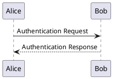
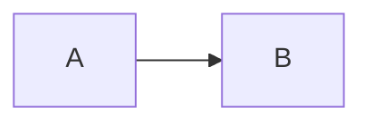

# Diagrams

A diagram is written inline as a fenced code block in a diagram language, or
kept in an external file and included with image syntax. Both forms take a
`Figure:` caption and behave like an image in the assembled document.

| Language | Code block   | File extensions      | External tool                |
| -------- | ------------ | -------------------- | ---------------------------- |
| PlantUML | `plantuml`   | `.puml`, `.plantuml` | `plantuml` (needs Java)      |
| Mermaid  | `mermaid`    | `.mmd`, `.mermaid`   | `mmdc`, or the built-in one  |
| Typst    | `typst`      | `.typ`               | `typst`                      |
| D2       | `d2`         | `.d2`                | `d2`                         |
| Draw.io  | not supported | `.drawio`           | `drawio`                     |

Every tool must be on `PATH` at build time. `docbake check` renders all
diagrams, so it finds diagram syntax errors before a full build.

## Inline diagrams

````markdown
Figure: Sequence diagram {#seq-diagram}


````

When the diagram source itself contains fences, open the outer block with more
backticks or with tildes.

## External diagram files

An image whose target has a recognised diagram extension is replaced by the
rendered diagram.

```markdown
Figure: Call flow {#call-flow}


```

Wrap a path that contains spaces in angle brackets:

```markdown

```

## Showing the source instead of the diagram

The `.as-code` class keeps the block as highlighted source. Use it in material
that teaches the diagram language.

````markdown

````

`.as-code` works for `mermaid`, `plantuml`, `typst`, and `d2`.

## Width and height

The `width` and `height` attributes set the diagram size. Each output format
accepts different units:

- HTML writes the values to the CSS `width` and `height` of the element around
  the diagram.
- PDF accepts `%`, `cm`, `mm`, `in`, `pt` and `em`. Typst rejects `px` and a
  number without a unit.
- DOCX accepts the units of images: `%`, `cm`, `mm`, `in`, `pt`, `em`, `px` and
  a number without a unit (pixels at 96 DPI). A width in `%` is a part of the
  text width. A height in `%` is a part of the text height. An invalid value
  stops the build.

Only `%` works in all formats. Use `width` in `%`.

````markdown
```d2 {width=50%}
a -> b
```
````

In DOCX, the diagram is a PNG image. With only one of the two attributes, the
diagram keeps its aspect ratio. Without the two attributes, the diagram has the
size of the PNG at the resolution of the tool: 144 DPI for Typst, 192 DPI for
D2 and 96 DPI for Mermaid, PlantUML and Draw.io. If a diagram is wider or taller
than the text area of the page, DOCX makes the diagram smaller to fit the text
area. The width and the height change by the same factor. With both attributes,
the diagram keeps the ratio of the two values.

## Mermaid

Mermaid suits HTML output best. Each format renders it differently:

- HTML renders Mermaid in the browser from a CDN.
- PDF uses `mmdc` (mermaid-cli) when it is on `PATH`, and the built-in renderer
  when it is not.
- DOCX needs `mmdc`. There is no fallback.

## Typst

Typst diagrams can use any Typst package, for example CeTZ or Fletcher.

For PDF, the diagram source is placed directly into the generated Typst
document. Fonts, colours, and packages behave exactly as they do in Typst.

For HTML, the source is compiled to SVG by `typst compile`. The builder wraps it
in `#set page(width: auto, height: auto, margin: 0pt)` so the SVG is cropped to
the content.

External `.typ` files work through image syntax.

## Draw.io

Draw.io diagrams come from external `.drawio` files only. Inline code blocks are
not supported.

Select a page of a multi-page file with a fragment. Numbering starts at 1.

```markdown

```

The `drawio` command-line tool converts the file: to SVG for HTML and
Confluence, to PDF for PDF, and to PNG for DOCX.

## D2

D2 renders to SVG through the `d2` command-line tool. Configuration such as the
layout engine and the theme goes in a `vars` block inside the diagram.

````markdown
```d2 {width=50%}
vars: {
  d2-config: {
    layout-engine: elk
    theme-id: 300
  }
}
network: {
  cell tower
}
```
````

The D2 project is currently unmaintained upstream. Prefer PlantUML or Mermaid
for new diagrams unless D2 gives a clear advantage, as it does for entity
diagrams.
